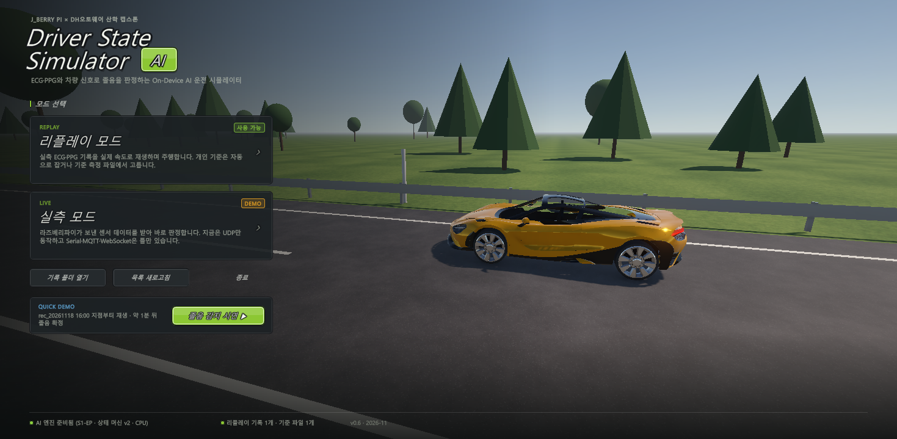
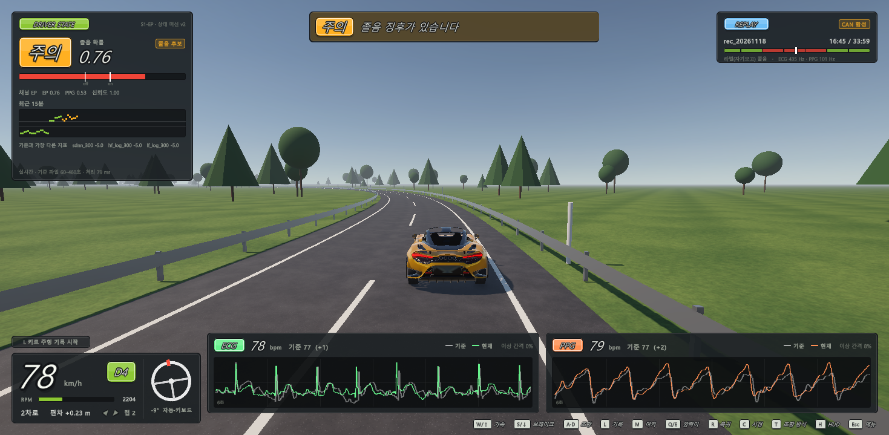

# J_Berry PI — 운전자 상태 분석 시뮬레이터

2026-2학기 산학 캡스톤 **"On-Device AI 기반 차량 운전자 상태 분석"** (J_Berry PI × DH오토웨어)의 Unity 운전 시뮬레이터입니다.

- **실측 ECG·PPG 기록**을 센서처럼 실시간으로 재생합니다.
- **차량 신호**(CAN과 비슷한 신호)를 시뮬레이터에서 만들어 냅니다.
- 팀 모델 저장소 [`26-2-J-berryPi-Capstone`](https://github.com/mingyu-mun/26-2-J-berryPi-Capstone)의 **S1-EP 학생 모델 + 상태 머신 v2**가 **각자의 PC CPU에서** 실시간으로 판정하고, 그 결과를 화면에 띄웁니다.

| 메인 메뉴 | 주행 화면 |
|---|---|
|  |  |

```
 Unity (센서·차량 에뮬레이터)                               Tools/jberry_ai/server.py  (Python .venv, torch CPU)
 ┌─────────────────────────────────┐  UDP 5005             ┌──────────────────────────────────────────────────┐
 │ BioReplay  실측 ECG/PPG 원신호    │ ─ bio (원래 주기) ───▶ │ engine.StreamEngine                               │
 │ AiLink     차량 신호 (simulated)  │ ─ can (50 Hz) ──────▶ │   저장소 전처리 → RR 추출 → 개인 기준 z            │
 │ SimPanels  파형·판정·출처 배지    │ ◀─ ui (10 Hz) ─────── │   → S1-EP 학생(3 seed 평균) → StateMachineV2      │
 └─────────────────────────────────┘  UDP 5006             └─────────────┬────────────────────────────────────┘
                                                                         ├─ SimLogs/ai/events_<세션>.jsonl  (웹보드 규약 v1.2)
                                                                         └─ (선택) 웹보드 대시보드 /api/events
```

## Unity 없이 실행 (팀원용)

`JberryDrivingSim_<날짜>.zip`을 받아 풀고 `JberryDrivingSim.exe`를 실행하면 됩니다. 휴대용 AI 엔진이 들어 있어 따로 설치할 것이 없습니다. 자세한 내용과 빌드 방법은 [docs/07_실행파일.md](docs/07_실행파일.md)에 있습니다.

## 빠른 시작 (Unity 에디터, 개발자용)

| 단계 | 할 일 | 자세히 |
|---|---|---|
| 1 | Unity Hub에서 **Unity 6000.6.9f1** 설치 후, 이 저장소 폴더를 프로젝트로 열기 (`Add > Add project from disk`) | [docs/01_설치.md](docs/01_설치.md) |
| 2 | 메뉴 **Capstone > AI 추론 환경 설치 (Python venv)** 실행 (Python 3.10~3.13 필요, 처음 한 번, 약 2~5분) | [docs/01_설치.md](docs/01_설치.md#3-ai-추론-환경-python) |
| 3 | 측정 기록을 유니티 안으로 변환: `python Tools/convert_recording.py "<측정 zip>" --out Assets/StreamingAssets/Replays/rec_20261118` (기준 파일은 `--role baseline --end 480`) | [docs/02_구동절차.md](docs/02_구동절차.md#1-replay-데이터-준비) |
| 4 | `Assets/Scenes/SampleScene` → **Play** → 메인 메뉴에서 **리플레이 모드** / **실측 모드(DEMO)** 선택 | [docs/02_구동절차.md](docs/02_구동절차.md#2-실행--메인-메뉴) |
| 5 | 시연: 리플레이 모드 → 기준 '자동 수집' → 시작 위치 **16:00** → 주행 시작 → 약 60초 뒤 졸음 확정 | [docs/02_구동절차.md](docs/02_구동절차.md#4-시연-시나리오) |

실측 기록이 없으면 다음 명령으로 만든 합성 파형으로 경로만 점검할 수 있습니다. 이 경우 판정 결과에는 의미가 없습니다.

```bash
python Tools/gen_synthetic_bio.py --out Assets/StreamingAssets/Replays/synthetic
```

## 문서

| 문서 | 내용 |
|---|---|
| [01_설치.md](docs/01_설치.md) | Unity·Python 설치, 차량 에셋(선택), 문제 해결 |
| [02_구동절차.md](docs/02_구동절차.md) | 데이터 준비 → Play → 조작키 → 시연 시나리오 → 주행 기록 |
| [03_규약.md](docs/03_규약.md) | **데이터·통신 규약**: 세션 폴더 형식, UDP 패킷, 웹보드 v1.2 이벤트 매핑, CAN 신호 매핑, 로그 컬럼 |
| [04_AI모델연동.md](docs/04_AI모델연동.md) | 실시간 엔진 구조, `causal`/`exact` 모드, 저장소 코드와 다른 점, 검증 결과 |
| [05_자동테스트.md](docs/05_자동테스트.md) | request.txt로 재컴파일 → Play → 스크린샷·리포트 자동 실행 |
| [06_실측모드.md](docs/06_실측모드.md) | 실측 모드(DEMO): 라즈베리파이 → 시뮬레이터 패킷 형식, UDP·Serial·MQTT·WebSocket 비교(지연), PC 한 대로 시험하기 |
| [07_실행파일.md](docs/07_실행파일.md) | Unity 없이 실행하는 Windows 실행 파일 (팀원 실행, 빌드·배포 zip) |
| [Tools/jberry_ai/README.md](Tools/jberry_ai/README.md) | 추론 서버 상세 |

## 저장소에 올리지 않는 것 (중요)

- **원신호·운전자 데이터**: `SimLogs/` 전체(생체 기록, 주행 로그, 판정 로그)와 `Assets/StreamingAssets/Replays/` 안의 기록은 `.gitignore`에 들어 있습니다. 측정 zip은 팀 공유 드라이브로 주고받고, 각자 `convert_recording.py`로 변환합니다.
- **Unity Asset Store 에셋**(Sport Car Free 등): 재배포가 금지되어 있으니 각자 받아서 Import합니다. 에셋이 없으면 코드로 만든 기본 차량이 나옵니다.
- **Python 가상환경**(`Tools/jberry_ai/.venv`): 각자 메뉴로 생성합니다.
- 모델 가중치(`Tools/jberry_ai/repo/models`)는 팀 모델 저장소에서 복사한 것입니다. 사용 조건은 [models/README.md](Tools/jberry_ai/repo/models/README.md)를 따릅니다 (WESAD 학습분은 비상업 용도).

## 폴더 구성

```
Assets/CapstoneSim/Scripts   시뮬레이터 런타임 (메인 메뉴·디자인 시스템(SimTheme)·도로·차량·입력·로거·HUD·Replay/실측 입력·AI 연결·패널·자동테스트)
Assets/StreamingAssets/Replays  리플레이·기준 측정 기록 (각자 넣음, git 제외)
Assets/CapstoneSim/Editor    Capstone 메뉴, 자동 테스트 감시, AI 환경 설치
Assets/Scenes/SampleScene    DrivingSim 오브젝트가 들어 있는 씬
Tools/jberry_ai              실시간 추론 서버 (engine.py, server.py, setup_env.py, selftest.py, repo/ = 팀 저장소 코드 일부)
Tools/convert_recording.py   측정 zip → Replay 세션 폴더
Tools/gen_synthetic_bio.py   합성 ECG/PPG (점검용)
Tools/rpi_bridge/rpi_sender.py  실측 모드 시험용 송신기 (라즈베리파이 흉내, UDP)
Tools/check_log.py           주행 로그 점검·SDLP·생체신호 정렬
docs/                        설치·구동·규약·모델·자동테스트 문서
```
