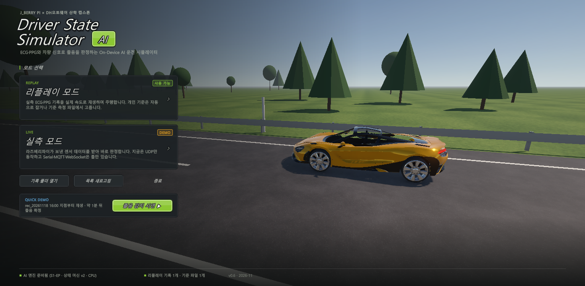
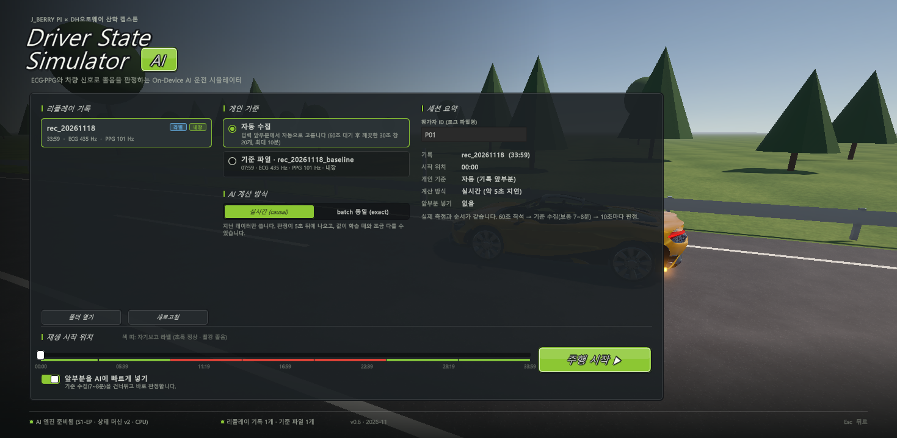
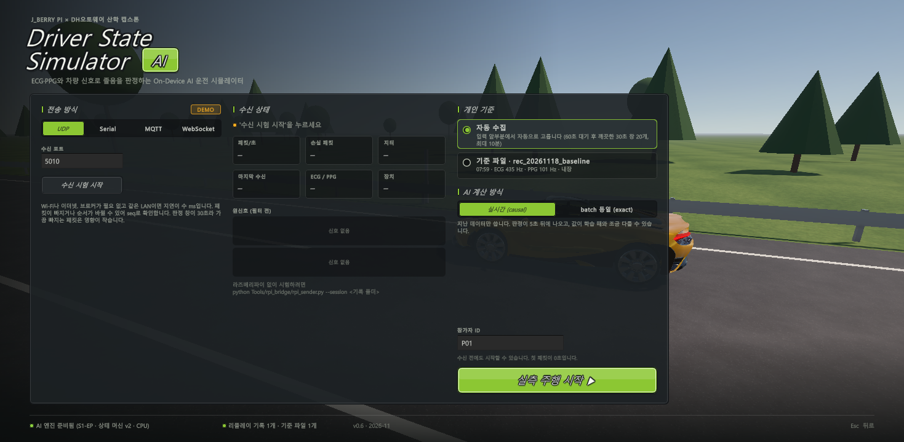

# 02. 구동 절차

## 1. Replay 데이터 준비

측정 프로그램이 저장한 zip을 시뮬레이터 세션 폴더로 변환해 **유니티 안**(`Assets/StreamingAssets/Replays/`)에 넣습니다. 원신호는 팀 공유 드라이브로 주고받고, **저장소에는 올리지 않습니다** (`.gitignore` 대상).

```bash
# 리플레이 기록 (전체)
Tools\jberry_ai\.venv\Scripts\python Tools/convert_recording.py "C:/Users/<me>/Downloads/측정 26.11.18 19 42.zip" --out Assets/StreamingAssets/Replays/rec_20261118
# 개인 기준(baseline) 측정 파일 — 안정 상태 구간만 잘라서 (예: 처음 8분)
Tools\jberry_ai\.venv\Scripts\python Tools/convert_recording.py "<같은 zip 또는 기준 측정 zip>" --out Assets/StreamingAssets/Replays/rec_20261118_baseline --role baseline --end 480
```

- 형식은 [03_규약.md 1절](03_규약.md#1-replay-세션-폴더)을 따릅니다. 폴더에는 `meta.json`, `ecg.csv`, `ppg.csv`, `labels.csv`가 들어갑니다.
- `--role baseline`으로 만든 폴더는 메뉴에서 **기준 측정 파일** 목록에 나옵니다. 이런 파일은 5~10분 동안 앉아서 안정 상태로 측정한 기록이 좋습니다.
- `SimLogs/bio/` 아래의 세션 폴더도 함께 목록에 나옵니다. 예전 변환본은 그대로 쓰면 됩니다.
- 기록 없이 경로만 점검하려면 `python Tools/gen_synthetic_bio.py --out Assets/StreamingAssets/Replays/synthetic`을 실행합니다. 이 합성 파형으로는 판정에 의미가 없습니다.

## 2. 실행 — 메인 메뉴

`Assets/Scenes/SampleScene` → **Play**하면 메인 메뉴가 뜹니다. 배경에서는 차량이 **모의 주행**(`CarAutopilot`: 차선 중앙을 따라가는 Stanley 조향 + 70 km/h 속도 유지)으로 트랙을 계속 돌고, 카메라가 그 주위를 천천히 돕니다. 메뉴에 오래 머물러도 차가 맵을 벗어나지 않습니다.

| 홈 | 리플레이 모드 | 실측 모드 (수신 시험) |
|---|---|---|
|  |  |  |

| 화면 | 할 일 |
|---|---|
| **홈** | 리플레이 모드 / 실측 모드(DEMO) 카드 중 하나를 고릅니다. 아래 상태 줄에서 AI 엔진 설치 여부와 기록 개수를 확인합니다. |
| **리플레이 모드** | ① 기록 선택 ② 개인 기준: 자동 수집 또는 기준 측정 파일 ③ AI 계산 방식(실시간 / batch 동일) ④ 재생 시작 위치(타임라인. 아래 색 막대는 참고 라벨) ⑤ 앞부분 빠른 입력 → **주행 시작** |
| **실측 모드 (DEMO)** | ① 전송 방식(UDP만 동작, Serial·MQTT·WebSocket은 틀) ② **수신 시험**으로 패킷/초, 손실, 흔들림, 원신호 미리보기 확인 ③ 개인 기준 ④ **실측 주행 시작**. 자세한 내용은 [06_실측모드.md](06_실측모드.md)에 있습니다. |
| **주행 중 Esc** | 세션 메뉴가 열립니다: 주행 계속 / 메인 메뉴로(세션 종료: 기록 정지, AI 서버 종료, 차량 원위치) / 시뮬레이터 종료 |

주행을 시작하면 다음 순서로 진행됩니다.
0. 모의 주행이 꺼지고, 차량이 **맵의 첫 지점(출발 직선 구간, 시작 차선)** 으로 순간 이동해 정지 상태로 초기화됩니다. 주행 로그에 `RESET session_start` 이벤트가 남습니다. 세션을 끝내고 메인 메뉴로 돌아갈 때도 같은 위치로 돌아간 뒤 모의 주행이 다시 시작됩니다.
1. 생체 입력(재생 또는 수신)이 시작됩니다.
2. `AiLink`가 `Tools/jberry_ai/.venv` 서버를 띄웁니다. 화면 위에 "AI 엔진 준비 중"이 뜨고 약 6초 걸립니다. 그동안 들어온 표본은 버리지 않고 쌓아 두었다가 보냅니다.
3. AI 패널은 기준 방식에 따라 다르게 진행됩니다.
   - **자동 수집**: 착석 대기(60초) → 기준 수집(깨끗한 30초 창 20개, 보통 7~8분) → 판정(10초마다)
   - **기준 파일**: 처음부터 바로 판정합니다.

메뉴 없이 바로 주행하려면 `DrivingSim`의 *Show Main Menu*를 끄면 됩니다. 그러면 Inspector 값(Bio Session Dir, Bio Start Offset Sec 등)으로 리플레이 세션이 바로 시작됩니다.

### 주행 화면 배치

| 위치 | 내용 |
|---|---|
| 왼쪽 위 | 운전자 상태: 상태 배지(정상·주의·졸음), 졸음 확률과 임계값, 최근 15분 판정 |
| 위 가운데 | 경고 배너 (주의·졸음일 때만) |
| 오른쪽 위 | 세션: 리플레이/실측, CAN 합성 표시, 재생 위치 또는 수신 상태 |
| 아래 | ECG·PPG 파형 (최근 6초). 개인 기준 파형을 흰색으로 겹쳐 그립니다 |
| 왼쪽 아래 | 속도·기어·RPM·차로·핸들, 그 위에 주행 기록 상태 |
| 맨 아래 오른쪽 | 조작키 |

## 3. 리플레이 설정 항목

| 항목 | 설명 |
|---|---|
| 개인 기준: **자동 수집** | 재생하는 기록의 앞부분에서 상태 머신 v2 규칙으로 기준 구간을 고릅니다 (60초 대기, 깨끗한 창 20개, 최대 600초). |
| 개인 기준: **기준 측정 파일** | 고른 파일 안에서 같은 규칙으로 기준 구간을 고릅니다. 규칙을 채우지 못하면 파일 전체를 쓰고 "(강제)"로 표시합니다. 기준이 미리 정해지므로 **시작 직후부터 판정**합니다. |
| AI 계산 방식 | 실시간(causal, 창 끝 + 5초) / batch 동일(exact, 창 끝 + 140초). 자세한 내용은 [04 2절](04_AI모델연동.md#2-두-가지-모드)에 있습니다. |
| 재생 시작 위치 | 타임라인을 클릭하거나 끌어서 정합니다 (10초 단위). |
| 앞부분 빠른 입력 | 시작 위치 앞의 실측값을 서버에 먼저 넣습니다. 화면에는 "앞 N s 빠른 입력"으로 표시됩니다. 자동 수집이면 0초부터 시작 위치까지 전부(기준 수집 포함), 기준 파일이면 시작 위치 앞 최대 300초(5분 특징 창 채우기)를 넣습니다. |
| 참가자 ID | 주행 로그 파일 이름(`drive_<ID>_…`)에 쓰입니다. |

## 4. 시연 시나리오

rec_20261118 기준입니다. 재생 시각은 원본 측정 시각에서 60초를 뺀 값입니다.

| 목적 | 기준 | 시작 위치 | 빠른 입력 | 예상 화면 |
|---|---|---|---|---|
| 실제 측정과 같은 흐름 | 자동 | 00:00 | - | 착석 대기 60초 → 기준 수집 → 약 8분 뒤부터 판정 |
| **졸음 감지 시연 (권장)** | 자동 | **16:00** | ✔ | 시작 직후 **주의**(졸음 후보, p 0.6~0.8) → **약 60초 뒤 졸음 확정**(빨간 배너 + 경고음) |
| 기준 파일 사용 시연 | `rec_20261118_baseline` | 16:00 | ✔ | 기준 파일(60~460초)로 바로 판정 시작 → 주의(후보, p 0.65~0.86) → 상태 머신 지속 조건을 채우면 졸음 확정 |
| 정상 구간 | 자동 | 08:00 | ✔ | 정상 (p 0.1~0.25) |
| 정상 복귀 | 자동 | 23:00 | ✔ | 졸음 → 24:10 주의 → 25:10 정상. 단, 26:20부터 다시 '주의'가 나옵니다 (라벨상 정상 구간이므로 오탐, [04 4절](04_AI모델연동.md#4-검증-결과-rec_20261118)). |

'기준 파일 사용 시연'에서 기준 파일은 같은 기록의 처음 8분을 잘라 만든 것입니다. 실제로는 별도의 기준 측정을 쓰는 것이 맞습니다.

## 5. 조작키

| 키보드 | 게임패드 | 기능 |
|---|---|---|
| W / ↑ | RT | 가속 |
| S / ↓ / Space | LT | 브레이크 (정지 상태에서 계속 누르면 후진) |
| A·D / ←→ | 왼쪽 스틱 | 조향 |
| **L** | Start | **주행 기록 시작 / 정지** |
| **M** | A | **동기화 마커** |
| Q / E | LB / RB | 좌 / 우 깜빡이 |
| R | Select | 차선 위로 복귀 |
| C | Y | 운전석 시점 ↔ 추적 시점 |
| T | | 조향 방식 전환 (자동 → 키보드 → 마우스 → 게임패드) |
| H | | HUD와 패널 표시 토글 |
| **Esc** | B | 세션 메뉴 (메뉴 화면에서는 뒤로) |

조향 방식은 `meta.json`의 `steer_mode`에 기록됩니다. **한 실험 안에서는 같은 장치로 통일**합니다. 게임패드가 없으면 마우스 방식을 권장합니다.

## 6. 출력 (모두 `SimLogs/`, 저장소에 올리지 않음)

| 파일 | 내용 |
|---|---|
| `drive_<ID>_<시각>.csv` / `_events.csv` / `_meta.json` | L 키로 기록한 주행 신호 (50 Hz), 이벤트, 세션 정보. 컬럼은 [03_규약 5절](03_규약.md#5-주행-로그-컬럼) |
| `ai/events_<세션>.jsonl` | 웹보드 규약 v1.2 이벤트 4종 (bio.wave, ai.decision, can.telemetry, system.status) |
| `ai/windows_<세션>.csv` | 창마다 WindowIn·StepOut·logit·처리 시간 |
| `ai/server_stdout.txt` | 서버 출력 |
| `autotest/<id>/` | 자동 테스트 스크린샷과 리포트 |

로그 점검: `python Tools/check_log.py SimLogs/drive_....csv --plot`
- 출력: 실제 기록 주기, SDLP, 차선 이탈, 조향 반전율
- `--sensor` 옵션을 주면 생체신호 CSV와 시간을 맞춥니다.
