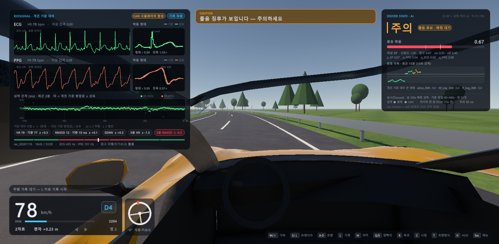

# 04. AI 모델 연동 (S1-EP + 상태 머신 v2)

- 모델 출처: [`mingyu-mun/26-2-J-berryPi-Capstone`](https://github.com/mingyu-mun/26-2-J-berryPi-Capstone). 복사한 커밋은 `Tools/jberry_ai/repo/SOURCE.txt`에 있습니다.
- `repo/`에는 추론에 필요한 파일 37개만 **수정 없이** 복사했습니다. 실시간에 필요한 부분만 `Tools/jberry_ai/engine.py`에서 감싸서 처리합니다.

## 1. 창 하나를 판정하는 과정

10초마다 30초 창 하나를 판정합니다. 함수는 `scripts/infer_bundle.py`와 같은 것을 씁니다.

1. **전처리·RR**
   - `extract_rr(rec, spec, "ecg")`: 노치·대역통과·100 Hz 리샘플을 거쳐 R-peak를 찾고 RR 간격을 구합니다.
   - PPG도 같은 방식으로 맥파 간격(PRV)을 구합니다.
2. **RR 특징 36개**
   - `scale_values()`를 스케일 $L \in \{30, 120, 300\}$ s마다 실행합니다.
   - 특징: HR, RR 평균, SDNN, RMSSD, pNN50, SD1, SD2, SD1/SD2, (120·300 s 스케일만) LF·HF·LF/HF·LFnu·DFA α1·SampEn
3. **개인 기준 정규화** (`PersonalNormalizer`, `z_matrix`)

   $$z_{j} = \operatorname{clip}\!\left(\frac{x_{j} - m_{j}}{\max(\sigma_{s,j},\ \sigma_{pop,j})},\ -5,\ 5\right)$$

   - $x_j$: 현재 창의 $j$번째 RR 특징 값
   - $m_j$: 기준 구간 창들에서 구한 같은 특징의 중앙값
   - $\sigma_{s,j}$: 기준 구간의 사분위 범위 / 1.349 (개인 산포)
   - $\sigma_{pop,j}$: 학습 참가자들의 산포 중앙값 (`bundle.json`의 `normalizer`). 개인 산포가 너무 작을 때 z가 폭발하지 않게 막는 하한입니다.
   - 결측은 0으로 둡니다.
4. **학생 모델 S1-EP** (seed 3개의 logit 평균)

   $$\ell = \frac{1}{3}\sum_{k=1}^{3} f_k\!\left(\mathbf{z},\ g_k(\mathbf{X}) - \operatorname{median}_r\, g_k(\mathbf{R}_r)\right), \qquad p_{EP} = \sigma(\ell) = \frac{1}{1+e^{-\ell}}$$

   - $\mathbf{X}$: 현재 창의 ECG·PPG 파형. 대역통과(ECG 0.5–25 Hz, PPG 0.5–8 Hz) 후 64 Hz로 리샘플하고, 30 s를 창별 z-score로 바꾼 것입니다 (`student_cache.prep/cut`).
   - $\mathbf{R}_r$: 기준 구간의 파형 창들 (최대 30개)
   - $g_k$: $k$번째 학생의 1D CNN 파형 인코더
   - $f_k$: 파형 임베딩 차이와 $\mathbf{z}$를 받아 logit을 내는 헤드
   - $\sigma$: 시그모이드
   - PPG 대체 경로는 파형의 ECG 채널을 0으로 가리고, $\mathbf{z}$ 대신 PRV로 만든 $\mathbf{z}_{PRV}$를 넣어 $p_{PPG}$를 냅니다.
5. **상태 머신 v2** (`StateMachineV2.step(WindowIn)`)
   - 입력: $p_{EP}, q_{ECG}, p_{PPG}, q_{PPG}$, HR, `can_drowsy=null`
   - $q$: 창 안의 이상 RR 비율
   - 채널 선택 → 최근 3창 중앙값 → 히스테리시스(on 0.55 / off 0.40) → 주의 40 s / 졸음 후보 60 s / 졸음 확정 180 s / 해제 60 s → level
6. **기준 측정 파일** (메뉴에서 고른 경우, `engine.use_baseline_recording`)
   - 그 파일 안에서 아래 7번과 같은 규칙으로 기준 구간을 고르고, 개인 프로필과 학생 기준 파형 $\mathbf{R}$을 만듭니다. 이후 입력은 0 s부터 바로 판정합니다.
   - 규칙을 채우지 못하면 $[\min(60,\ 0.2T),\ T]$를 강제로 쓰고 "(강제)"로 표시합니다. $T$는 파일 길이입니다.
   - 주의: 300 s 스케일 특징은 **입력이 시작된 뒤 300 s가 지나야** 다 채워집니다. 그전에는 일부 특징이 결측이 되고, 3번 식에 따라 $z=0$(=기준과 같음)이 되므로 판정이 보수적으로 나옵니다. rec_20261118로 확인한 결과는 다음과 같습니다.
     - 960 s부터 바로 시작하면 p가 0.04~0.2였습니다.
     - 앞 300 s를 함께 넣으면 p가 0.65~0.86이었습니다. 이 값은 연속 재생 결과와 비슷합니다.
   - 화면에는 "장기(5분) 특징 창 채우는 중 n%"로 표시합니다.
7. **기준 수집** (`select_baseline`)
   - 60 s 착석 대기 후, 이상 비율 $q \le 0.05$인 깨끗한 30 s 창 20개가 300 s 안에 모이면 확정합니다.
   - 모자라면 구간을 넓히며, 최대 600 s까지 기다립니다.
   - 5초마다 다시 계산합니다.

### 화면용 '기준 대비' 비교 (표시 전용, 판정에는 쓰지 않음)

생체 신호 패널에서 현재 신호가 개인 기준에서 얼마나 벗어났는지 보여 주기 위해, 서버가 창마다 아래 값을 함께 계산합니다 (`engine._compare`). 모델 입력이나 상태 머신에는 들어가지 않습니다.

1. **박동 형태 템플릿.** 공통 전처리를 거친 100 Hz 신호 $y$에서 박동 기준점 $b_i$ (ECG는 R-peak, PPG는 맥파 정점) 마다 $[b_i - a,\ b_i + c)$를 잘라 표본별 중앙값을 냅니다.

   $$T[n] = \operatorname{median}_{i}\ y\!\left(b_i - a + \tfrac{n}{f_s}\right), \qquad n = 0, \dots, (a+c) f_s - 1$$

   - $T_{base}$: 기준 구간 $[t_a, t_b)$ 안의 박동으로 만든 템플릿, $T_{now}$: 현재 30 s 창 안의 박동으로 만든 템플릿
   - $a, c$: 기준점 앞·뒤 길이. ECG $0.25 / 0.45$ s, PPG $0.45 / 0.40$ s
   - $f_s = 100$ Hz. 박동이 3개 미만이면 만들지 않습니다.
   - 화면에는 두 템플릿을 각자 중앙값을 빼고 **기준 템플릿의 진폭 범위** $\operatorname{ptp}(T_{base})$로 나눠 겹쳐 그립니다. 그래서 진폭 변화가 그대로 보입니다.
2. **형태 일치도와 진폭 비**

   $$r = \operatorname{corr}(T_{base}, T_{now}), \qquad A = \frac{\operatorname{ptp}(T_{now})}{\operatorname{ptp}(T_{base})}$$

   - $r$: 피어슨 상관계수. 1에 가까울수록 박동 모양이 기준과 같습니다.
   - $A$: 진폭 비. 기준과 같으면 1.00입니다.
   - 화면에서는 $r < 0.9$ 이거나 $A$가 $[0.7, 1.3]$을 벗어나면 주황색으로 표시합니다. 이 경계는 눈에 띄게 하기 위한 화면용 값이며, 검증된 임상 기준이 아닙니다.
3. **심박 간격 타코그램.** 창 끝 기준 최근 120 s의 RR(ECG)·PP(PPG) 간격을 점으로 찍고, 기준 구간 정상 간격의 중앙값 $\tilde{m}$과 견고한 산포 $s = \mathrm{IQR}/1.349$로 $\tilde{m} \pm s$ 띠를 그립니다. 이상 간격은 회색으로 표시합니다.
4. **이탈 칩.** HR·RMSSD·SDNN(30 s)과 HR·RMSSD(300 s)의 z를 보여 줍니다. 위 3번 식의 $z_j$와 **같은 값**입니다. $|z| \ge 2$이면 주황, $|z| \ge 3$이면 빨강입니다.

## 2. 두 가지 모드

저장소의 교사 RR 특징은 **창 중심** $c = t + 15$ s를 기준으로 $[c - L/2,\ c + L/2)$ 구간에서 계산합니다 (`teacher/features.py: session_windows`).
- $t$: 창 시작 시각
- $L$: 스케일

300 s 스케일은 창이 끝난 뒤 $c + 150 - (t + 30) = 135$ s의 **미래 심박**까지 씁니다. 오프라인 batch에서는 괜찮지만, 실시간에서는 아직 없는 데이터입니다.

| 모드 | 스케일 구간 | 출력 시점 | 의미 |
|---|---|---|---|
| `exact` | $[c - L/2,\ c + L/2)$ (학습과 같음) | 창 끝 + 140 s | batch와 같은 입력이지만 늦습니다. |
| `causal` (기본) | $[t_{end} - L,\ t_{end})$ (과거만) | 창 끝 + 5 s | 실시간이지만 학습 때와 입력 분포가 다릅니다. |

두 모드 모두 버퍼 끝 5 s는 필터 가장자리 효과를 피하려고 판정에 쓰지 않습니다.

## 3. 저장소 코드와 다른 점

1. **R-peak 및 맥파 검출 임계값**
   - 저장소의 `detect_ecg_peaks`는 높이 임계값을 *세션 전체* 에너지 $e = (\text{5–15 Hz 대역통과 ECG})^2$의 99 백분위 × 0.3으로 잡습니다.
   - 실시간에는 그때까지 받은 신호만 있어서, 초반 움직임 잡음 몇 초 때문에 임계값이 튀었습니다. rec_20261118의 첫 460 s에서 박동이 618개에서 247개로 줄었습니다.
   - 그래서 **조각마다 구한 값의 중앙값**으로 바꿨습니다. 조각 길이는 버퍼 길이 ÷ 6을 10~60 s로 제한한 값입니다. 버퍼가 길면 60 s 조각이 되어 batch와 거의 같고, 실측 시작 직후처럼 버퍼가 짧아도 조각이 여러 개라 초반 잡음 하나에 끌려가지 않습니다 (2026-11-21, 실측 모드 시험에서 발견). PPG의 prominence 기준 `0.3·std`도 같은 방식으로 바꿨습니다.
   - 전체 기록에서 batch 박동 2726개가 모두 ±20 ms 안에 다시 잡히고, 12개가 추가로 잡혔습니다. PPG는 2652개 그대로입니다.
   - 저장소 파일은 그대로 두고, `engine.use_realtime_detectors()`가 실행 중에 함수를 바꿔 끼웁니다.
2. **기준 수집 실패 시**: 600 s 안에 실패하면 `retry_required`를 표시합니다. 기록 재생에서는 재측정을 할 수 없으므로 `infer_bundle --force`처럼 기본 구간으로 진행하고, 화면에 "(강제)"를 붙입니다.
3. **판정 시작 위치**: 기준 구간과 겹치는 창은 판정하지 않고, 기준이 끝난 직후 창부터 판정합니다. batch의 `session_windows(skip=…)`와 같습니다.

## 4. 검증 결과 (rec_20261118)

- 작업 환경에서 전체 기록을 1 s 조각으로 스트리밍해 batch(`infer_bundle.py`)와 비교했습니다.
- 그 결과를 PC Unity 자동 테스트(`ai11_drowsy`)에서 다시 확인했습니다. 판정 시점과 p 값이 같았습니다.

| 비교 | 결과 |
|---|---|
| 같은 기준 구간에서 exact vs batch | 상태 일치 94~95 %, logit 차이 중앙값 0.14~0.16 |
| causal vs batch | 상태 일치 38 %, logit 상관 0.19. **입력 분포가 다릅니다.** |

참가자 자기보고 라벨(원본 10~25분 졸음)과 비교한 결과입니다. 기준 구간 이후 창만 썼습니다.

| 경로 | 창 AUROC | 5분 블록 AUROC | 주의 이상 비율 | 졸음 확정 구간 (원본 시각) | 졸음 블록 '졸음' 비율 / 정상 블록 '졸음' 비율 |
|---|---|---|---|---|---|
| batch | 0.59 | 0.78 | 0.91 | 1005 ~ 2100 s | 0.23 / 0.64 |
| 스트리밍 exact | 0.64 | 0.89 | 0.87 | 1035 ~ 1950 s | 0.20 / 0.53 |
| 스트리밍 causal | 0.58 | 0.67 | 0.77 | 1065 ~ 1500 s | 0.48 / 0.00 |

- **한 명, 한 세션의 결과라 일반화할 수 없습니다.**
- causal 모드는 창 단위 분리력이 떨어졌습니다. 대신 정상 블록에서 졸음이 남는 현상(batch 0.64)은 없어졌습니다.
- 정상 블록 후반(원본 1640 s 이후)에는 '주의'가 다시 나옵니다.
- **팀 검토 제안**: 실시간 시연용이라면 과거 구간 특징(`causal`)으로 학생 모델을 다시 증류하거나, 교사 특징의 스케일 구간을 바꿔서 다시 학습하는 것을 검토할 필요가 있습니다.

## 5. 성능 (Windows PC, CPU)

| 항목 | 값 |
|---|---|
| 모델 로드 | 약 6 s |
| 창 하나 판정 | 70~100 ms (10 s마다) |
| RR 전체 재추출 | 34분 기록에서 0.3 s 미만 |
| Unity 화면 | 500 FPS 이상 (자동 테스트 기준) |
